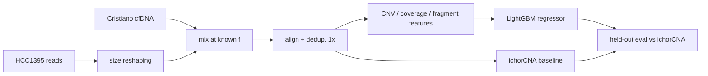
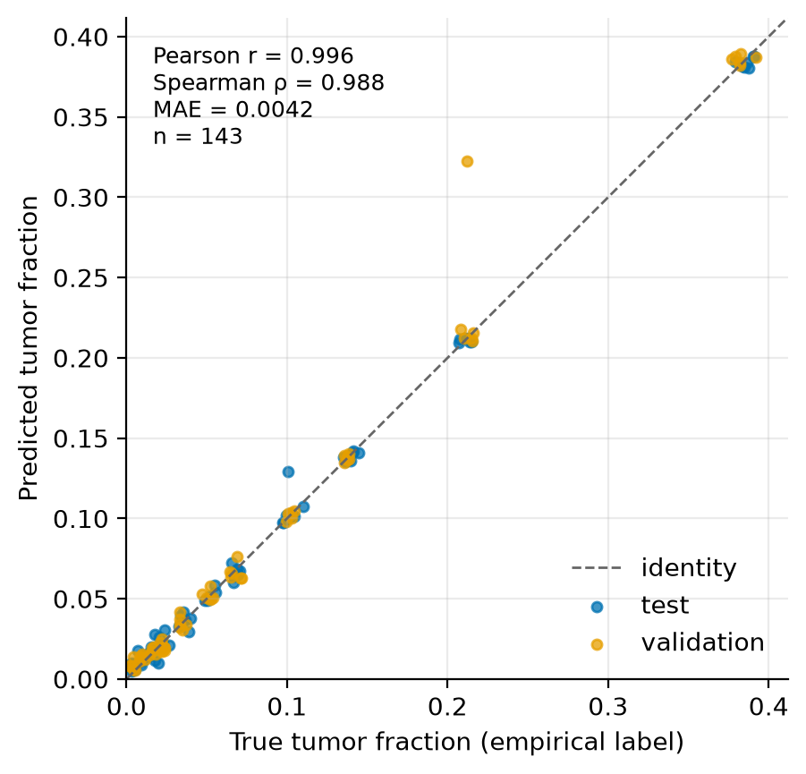

# flash_fraq

Estimate ctDNA **tumor fraction** from low-pass cfDNA with a gradient-boosting regressor on copy-number and fragment-size features, benchmarked head-to-head against ichorCNA.

[](https://github.com/fragmentome/flash_fraq/actions/workflows/ci.yml)
[](LICENSE)
[](pyproject.toml)
[](https://doi.org/10.5281/zenodo.XXXXXXX)

> **Research use only. Not clinically validated.** The reported results are on *in silico* mixtures of a
> single cell line into donor cfDNA, not on patient plasma with a known tumor fraction.

## Problem

Tumor fraction (TF) is the share of cell-free DNA in a plasma sample that comes from the tumor. Estimating
it from cheap ~1x whole-genome sequencing is useful for monitoring and for deciding whether a sample is
informative at all. It is hard because the signal is faint at low TF, copy-number callers such as
[ichorCNA](https://github.com/broadinstitute/ichorCNA) cannot see tumors that are near-diploid, library
and batch effects can masquerade as signal, and 1x coverage leaves very few reads per genomic bin. The
project asks one falsifiable question (see [docs/motivation-and-goal.md](docs/motivation-and-goal.md)):
*can DELFI-style fragment-size features, trained directly against a continuous TF label, recover TF where
ichorCNA's copy-number estimate fails?* A negative answer counts as a result.

## Method

**Data.** Labels are true by construction: tumor reads are mixed into healthy cfDNA at known fractions.

| Role | Source | Accession |
| --- | --- | --- |
| Tumor / matched normal | SEQC2 HCC1395 / HCC1395BL cell lines | SRA [SRP162370](https://www.ncbi.nlm.nih.gov/sra/?term=SRP162370) |
| cfDNA backgrounds (`real_background`) | Cristiano et al. 2019 (DELFI), healthy donors only (per-sample phenotype filter) | EGA [EGAS00001003611](https://ega-archive.org/studies/EGAS00001003611) (controlled access) |
| cfDNA cohort used in QC | Snyder et al. 2016 | GEO [GSE71378](https://www.ncbi.nlm.nih.gov/geo/query/acc.cgi?acc=GSE71378) |

Reads are aligned to hg19 (BWA-MEM), deduplicated once after merging, and downsampled to 1x-equivalent. The
tumor reads are first **fragment-size reshaped** to cfDNA-like lengths (sheared gDNA otherwise leaks "fraction
of cell-line library" into every fragment feature; see [the audit](docs/results-corruption-audit.md)). Each
mixture yields 3,681 features: CNV log-ratio bins, chromosome-arm z-scores, GC-corrected coverage windows,
DELFI short/long ratios and fragment-size summary stats. Labels are the empirical TF from HCC1395 somatic SNV
allele fractions. The 484 `real_background` mixtures are split **by donor** into 341 train / 143 held-out
(validation + test), so no donor spans two splits; 11 `matched_pair` mixtures (tumor vs. its own normal) get
a descriptive report only.

**Model.** One LightGBM regressor per regime; input is a row of the feature matrix (up to 3,681 features),
output a scalar TF. 300 trees, up to 31 leaves each (a tree ensemble has no fixed parameter count).
`--feature-set` selects `all`, `cnv_only` or `fragment_only` columns.

**Loss.** LightGBM's default squared error, `L = (1/n) Σ (f̂ᵢ − fᵢ)²`, on the empirical TF label.

**Training.** lr 0.05, subsample 0.8, colsample 0.8, min_child_samples 10, seed 42 (all in
[`workflow/config/tf_model.yaml`](workflow/config/tf_model.yaml)). No early stopping; validation rows are held
out, not tuned on. Hardware and wall time of the reported run were not recorded; the smoke test trains in seconds
on CPU.



## Results

Held-out `real_background` mixtures (n = 143; "low" = true TF < 5%, n = 68). Lower is better for RMSE/MAE.
Source: [`docs/results/metrics.json`](docs/results/metrics.json), recomputed by `scripts/make_figures.py` from the
saved models and feature matrix (the `all` run), and matching the evaluation reports in
[docs/reshaped-admixture-results.md](docs/reshaped-admixture-results.md).

| Method | RMSE | MAE | Pearson r | Spearman ρ | RMSE (low) | Spearman ρ (low) |
| --- | --- | --- | --- | --- | --- | --- |
| ichorCNA (`low_tf` prior), baseline | 0.0700 | 0.0432 | 0.984 | 0.909 | 0.0144 | 0.359 |
| LightGBM, `all` features | **0.0104** | **0.0042** | 0.996 | 0.988 | 0.0046 | 0.917 |
| LightGBM, `cnv_only` | 0.0123 | 0.0045 | 0.994 | 0.988 | **0.0045** | 0.915 |
| LightGBM, `fragment_only` | 0.0426 | 0.0317 | 0.928 | 0.799 | 0.0328 | 0.322 |

What this shows: the supervised model beats ichorCNA by ~7x in RMSE overall and ~3x below 5% TF, but the gain
comes from copy-number features (~90% of split importance); fragment features alone are *worse* than ichorCNA
below 5% TF (detection floor 3%). So the headline question is, on this design, answered **no**.



*Held-out `real_background` mixtures, `all`-features model (n = 143). One validation mixture at true TF ≈ 0.21 is
predicted at ≈ 0.32; a test mixture at ≈ 0.10 is predicted at ≈ 0.13.*

<details><summary>Other figures</summary>

Generated by `scripts/make_figures.py` into `docs/figures/`: `bland_altman.png`,
`error_by_tumor_fraction_bin.png` (MAE with bootstrap CIs, ichorCNA alongside), `cohort_overview.png`.
Not produced: fragment-length distributions (per-sample length histograms are not persisted) and training curves
(boosting rounds are not logged).
</details>

**Limitations.**
- A single tumor (HCC1395, highly aneuploid) is mixed into all samples, so the model partly learns *that
  karyotype*; there is **no near-diploid test**, which is the regime the question is about.
- Public data only; the cfDNA backgrounds are controlled-access, so the full pipeline cannot be rerun without an EGA DAC grant.
- The decoy-QC gate's library-confound check was **overridden** for this run: a permutation null showed the fixed |0.1| threshold is miscalibrated ([§2](docs/reshaped-admixture-results.md)).
- The 11 `matched_pair` mixtures still use unreshaped tumor reads; they are descriptive only.
- Not clinically validated; research use only.

## How to run

Needs Python ≥ 3.14. The smoke test needs only the Python packages; the full pipeline also needs `bwa`,
`samtools`, `bcftools`, `bedtools` and R/ichorCNA (`environment.yml`).

```bash
git clone https://github.com/fragmentome/flash_fraq && cd flash_fraq
python3.14 -m venv .venv && source .venv/bin/activate
pip install -r requirements-lock.txt && pip install -e ".[dev,figures]"   # or: conda env create -f environment.yml
```

**Smoke test** (synthetic data, a few seconds; trains and evaluates through the real CLIs):

```bash
python scripts/smoke_test.py --workdir /tmp/flash_fraq_smoke
pytest -q tests                      # unit + integration tests, ~20 s
```

**Real data.** Accessions, access tiers and disk expectations (multiple TB for FASTQ/BAM) are in
[`data/README.md`](data/README.md); site paths go in `workflow/config/*.yaml`. The Snakemake workflows
(`workflow/`, local and SLURM profiles) take reads through to the feature matrix; then:

```bash
python scripts/train_tf_model.py --feature-matrix-path FEATURE_MATRIX.csv --output-root MODELS/ --feature-set all
python scripts/run_tf_eval.py    --feature-matrix-path FEATURE_MATRIX.csv --model-root MODELS/ --feature-set all \
                                 --report-path MODELS/tf_eval_report.json
python scripts/make_figures.py   --feature-matrix FEATURE_MATRIX.csv --model-root MODELS/ --feature-set all
```

To try the figure script without real data, point it at the smoke-test output and a scratch directory so
nothing synthetic lands in `docs/`:

```bash
python scripts/make_figures.py --feature-matrix /tmp/flash_fraq_smoke/feature_matrix.csv \
  --model-root /tmp/flash_fraq_smoke/models --feature-set cnv_only --out-dir /tmp/figs --results-dir /tmp/res
```

## Repo layout

```
src/flash_fraq/   pipeline modules (admixture, fragment extraction, GC correction, features, tf_model, tf_eval)
scripts/          CLI entrypoints; train_tf_model.py, run_tf_eval.py, make_figures.py, smoke_test.py
workflow/         Snakemake rules, configs, local + SLURM profiles
tests/            unit and integration tests (synthetic fixtures)
manifests/        HCC1395 run manifests (no sequence data)
docs/             design docs, results write-ups, figures/, results/
data/             README only; data is never committed
```

Start at [docs/README.md](docs/README.md) for the design and write-up index.

## Citation

See [`CITATION.cff`](CITATION.cff). The DOI is issued on first release.

```bibtex
@software{mykhailichenko_flash_fraq,
  author  = {Mykhailichenko, Matvii},
  title   = {flash\_fraq: fragmentomics-first ctDNA tumor fraction estimation from low-pass cfDNA},
  version = {0.1.0},
  doi     = {10.5281/zenodo.XXXXXXX},
  url     = {https://github.com/fragmentome/flash_fraq}
}
```

## License and data sources

MIT, see [LICENSE](LICENSE). Built on public data: SEQC2 HCC1395/HCC1395BL; Cristiano et al. 2019
(*Nature* 570, DELFI; EGA, DAC-controlled); Snyder et al. 2016 (*Cell* 164, GSE71378). Baseline: ichorCNA
(Adalsteinsson et al. 2017). Thanks to the original data producers.
